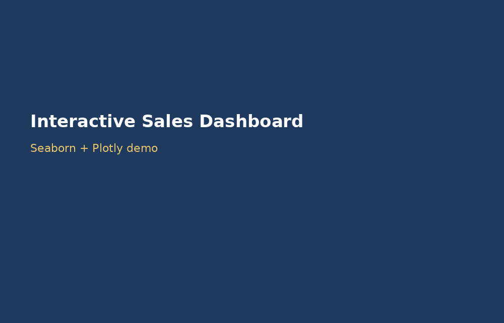
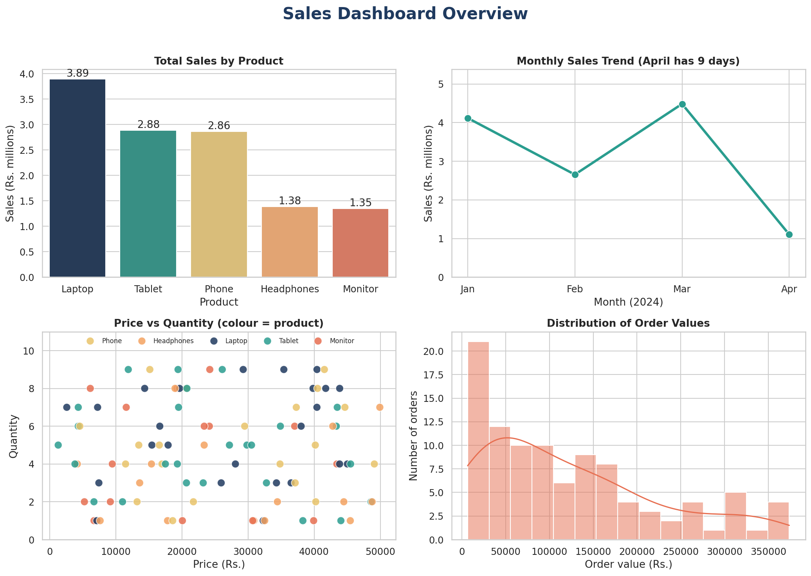
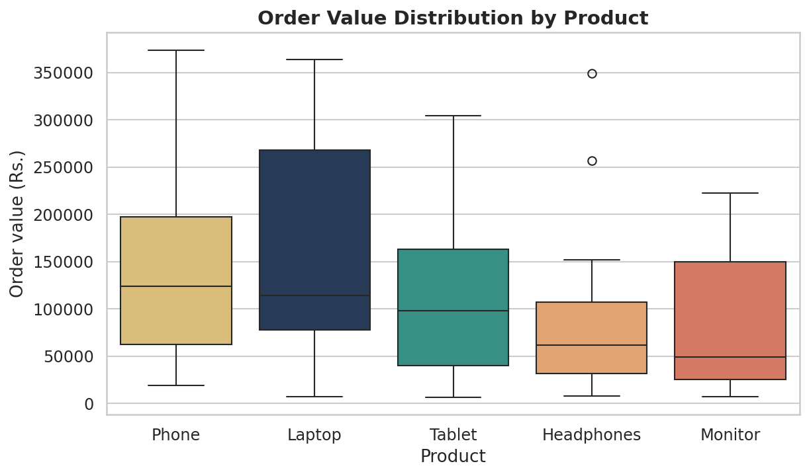
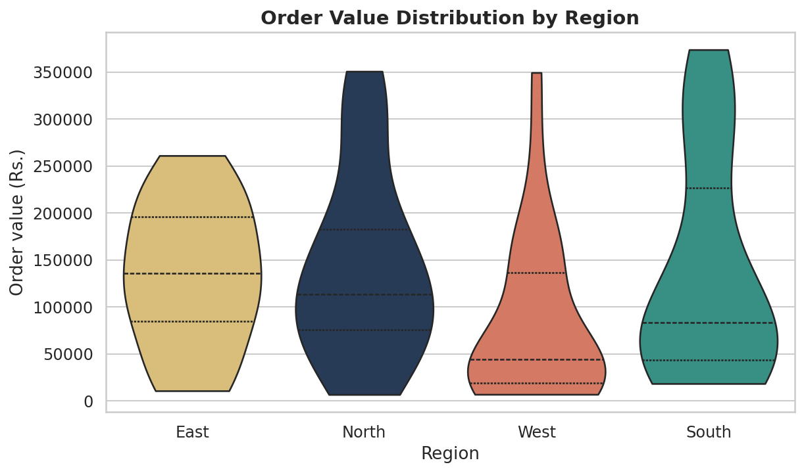
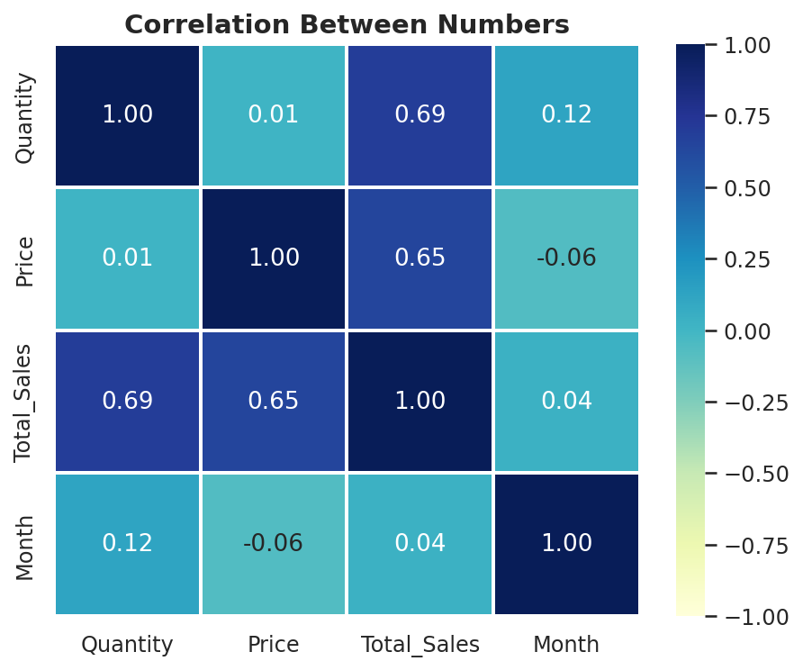

# Interactive Sales Dashboard

## Project Overview
This project builds an interactive sales dashboard in Python using Seaborn (statistical charts) and Plotly (interactive charts). It uses a sales dataset of 100 orders (1 January to 9 April 2024) and shows sales trends, product performance and the spread of order values. The dashboard has 8 charts of 9 different chart types, one colour scheme, a 2x2 dashboard grid and interactive elements (hover details, dropdown menus and an animation).

## Setup Instructions
1. Install Python 3 from python.org (or use Google Colab, which needs no installation).
2. Install the libraries with: pip install -r requirements.txt
3. Download sales_data.csv from the Developers Arena Week 6 task page and put it in the same folder as dashboard.py.
4. Run the dashboard with: python dashboard.py
5. The charts are saved in the visualizations folder and the demo GIF is saved as dashboard_demo.gif.
6. Open the .html files in the visualizations folder in a web browser to use the interactive charts.

You can also open dashboard.ipynb in Google Colab, run the cells in order, and upload sales_data.csv when asked.

## Code Structure
- dashboard.py : one script that loads and cleans the data, makes all charts and creates the demo GIF
- dashboard.ipynb : the Colab notebook version with the charts and their output
- requirements.txt : the libraries needed (pandas, matplotlib, seaborn, plotly, pillow)
- dashboard_demo.gif : an animated walkthrough of the dashboard
- visualizations/ : the 8 charts (4 pictures and 4 interactive HTML files)

## Visual Documentation
Demo (animated walkthrough of the Seaborn charts and the month-by-month animation):

The 2x2 dashboard grid:

Interactive charts (open in a browser, or download the file and double-click it):
- [Interactive dashboard (4 panels)](https://htmlpreview.github.io/?https://github.com/Sahana58-web/devarena-week6-sales-dashboard/blob/main/visualizations/8_interactive_dashboard.html)
- [Bar chart with a dropdown](https://htmlpreview.github.io/?https://github.com/Sahana58-web/devarena-week6-sales-dashboard/blob/main/visualizations/5_interactive_bar_dropdown.html)
- [Line chart with a region dropdown](https://htmlpreview.github.io/?https://github.com/Sahana58-web/devarena-week6-sales-dashboard/blob/main/visualizations/6_interactive_line_dropdown.html)
- [Animated sales by month](https://htmlpreview.github.io/?https://github.com/Sahana58-web/devarena-week6-sales-dashboard/blob/main/visualizations/7_animated_sales_by_month.html)

If a preview link does not load, download the .html file from the visualizations folder and open it in your browser.

## Dashboard Guide: What Each Chart Shows

### 1. Box plot: order value by product (Seaborn)

The box shows where the middle half of the orders for each product fall, and the line inside the box is the median. Phone has the highest median order (Rs.123,922), followed by Laptop (Rs.113,720), Tablet (Rs.97,788), Headphones (Rs.61,624) and Monitor (Rs.49,280). Laptop has the widest box, so its order values vary the most. Headphones has two unusually large orders (Rs.256,878 and Rs.349,510), shown as dots.

### 2. Violin plot: order value by region (Seaborn)

The width of each shape shows how many orders have that value, and the dashed line is the median. East has the highest median order (Rs.135,980) but only 19 orders. West has the lowest median (Rs.43,768): most West orders are small, with a few very large ones (up to Rs.349,510). South has two humps, meaning it has both many small orders and many large orders.

### 3. Correlation heatmap (Seaborn)

A value close to 1 means two numbers rise together, and a value close to 0 means no link. Total_Sales is linked with Quantity (0.69) and Price (0.65), which makes sense because order value is quantity times price. Quantity and Price are not linked with each other (0.01). Month has almost no link with the other numbers (all between -0.06 and 0.12). This is based on only 100 orders, and a correlation does not prove one thing causes another.

### 4. Dashboard grid with 4 charts (Seaborn)

- **Bar chart (top left):** total sales by product. Laptop leads with Rs.3.89 million, then Tablet (2.88) and Phone (2.86). Headphones (1.38) and Monitor (1.35) are lowest.
- **Line chart (top right):** monthly sales. January Rs.4.12M, February Rs.2.66M, March Rs.4.49M (the best month). April (Rs.1.10M) has only 9 days of data, so it should not be compared with full months.
- **Scatter plot (bottom left):** price against quantity for each order. The points are spread evenly with no pattern, which agrees with the correlation of 0.01. Every product appears across the whole price range.
- **Histogram (bottom right):** most orders are small. The median order is Rs.97,956, 51 of the 100 orders are under Rs.100,000, and 10 orders are above Rs.300,000.

### 5. Interactive bar chart with a dropdown (Plotly)
Hover over a bar to see its value, units sold and number of orders. Use the dropdown to switch between Total Sales, Units Sold, Average Order and Number of Orders. The ranking changes with the measure: for example, Laptop has the highest total sales and units sold (136), while Headphones has the fewest units (48).

### 6. Interactive line chart with a region dropdown (Plotly)
Use the dropdown to show the monthly sales of all regions together or of one region. This makes it easy to compare how each region moves from January to April and where its peak is.

### 7. Animated bar chart (Plotly)
Press Play to watch sales by product change month by month from January to April. The bar heights change a lot between months, which shows that product sales are not steady from one month to the next.

### 8. Full interactive dashboard (Plotly)
Four panels in one page: total sales by product (bar), monthly trend (line), share of sales by region (donut chart: North 32.2%, South 30.2%, East 20.4%, West 17.2%) and price against quantity (scatter). Hover over any point to see details, including the customer ID in the scatter plot, and click a product name in the legend to hide or show it.

## Technical Details
- Data loading and cleaning (pandas): read_csv, removal of missing values and duplicates, conversion of Date to a real date, and extraction of month and month name.
- Error handling: if the CSV file or a required column is missing, the program prints a clear message instead of crashing.
- Seaborn: boxplot, violinplot, heatmap, barplot, lineplot, scatterplot and histplot, on a shared theme and colour scheme, with a 2x2 grid made using matplotlib subplots.
- Plotly: graph_objects and express charts with hover templates, dropdown menus (updatemenus), an animation (animation_frame) and a 4-panel dashboard made with make_subplots. The charts are saved as HTML files.
- Colour scheme: one palette (navy, teal, yellow, orange and red) is used for the same product or region in every chart.
- Demo GIF: made with Pillow from the saved charts plus a month-by-month animation. It is a walkthrough of the dashboard, not a screen recording.

## Testing Evidence
- dashboard.py runs from start to finish and creates all 8 chart files and the demo GIF.
- Data checks: 100 rows loaded, 0 missing values, 0 duplicate rows.
- The numbers agree between charts: product totals, region totals and monthly totals all add up to Rs.12,365,048.
- The dropdown values in the interactive charts and the 4 animation frames (January to April) were checked against the data tables.
- The error messages for a missing file or missing columns are built into load_data().

## What I Learned
I learned how to use Seaborn for statistical charts (box plots, violin plots and heatmaps), how to combine charts into a dashboard grid, how to add hover details, dropdown menus and animation with Plotly, and how to keep one colour scheme across a whole dashboard. I also learned to describe what each chart tells us, and to be careful about conclusions, for example when April has only 9 days of data.
